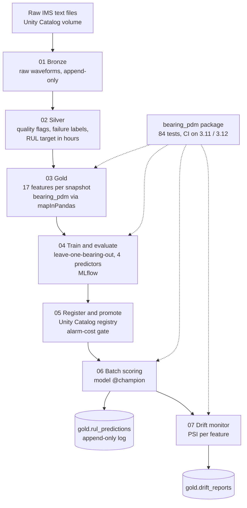

# bearing-rul-pipeline

Remaining-useful-life prediction for rolling-element bearings, starting from
raw 20 kHz accelerometer signals rather than a pre-built feature table.

The repository has two layers. `bearing_pdm/` is a plain Python package that
does the signal processing, evaluation and drift statistics, covered by 84
unit tests. `databricks/` runs that same package on Databricks: a Delta Lake
medallion (Bronze, Silver, Gold), model evaluation and registry in MLflow and
Unity Catalog, batch scoring, drift monitoring, and two scheduled jobs defined
as code with a Databricks Asset Bundle.

Data: the NASA IMS run-to-failure bearing dataset.

| | |
|---|---|
| Raw data processed | 12,560 one-second snapshots (8 bearings, 20,480 samples each) |
| Features | 17 per snapshot, time domain + FFT + envelope spectrum |
| Evaluation | leave-one-bearing-out, scored on alarm cost, not only RUL error |
| Champion model | gradient boosting, alarm cost 3,796 vs 6,180 for a time-only baseline (-39%) |
| Late-prediction score | 76.4 vs 4,215 for the time-only baseline |
| False alarms on unseen healthy bearings | 0 |

---

## The problem

A rolling-element bearing fails at one of four places: the outer race, the
inner race, a rolling element, or the cage. A small defect grows under load
until the bearing seizes. An accelerometer on the housing records this as
vibration, 20,000 samples per second, and no single sample means anything.

A maintenance team needs one decision from that stream: should this machine
be stopped for inspection in the next two days? Stopping a healthy machine
costs an inspection. Missing a failing one costs the machine. The project is
built around that decision and around measuring how often it would be wrong.

---

## Data

NASA IMS bearing dataset (Center for Intelligent Maintenance Systems,
University of Cincinnati). Four bearings on one shaft at 2,000 RPM under a
constant radial load, recorded until something failed. Each snapshot is
20,480 samples at 20 kHz (about one second). Test 2 has one snapshot every
10 minutes; test 1 averages one every 23 minutes because of recording gaps,
which is why RUL is computed from timestamps and not from snapshot counts.

| Test | Snapshots | Channels | Duration | Failed |
|---|---:|---:|---:|---|
| 1 | 2,156 | 8 (2 per bearing) | 827.6 h | bearing 3 (inner race), bearing 4 (rolling element) |
| 2 | 984 | 4 | 163.8 h | bearing 1 (outer race) |
| 3 | 6,324 | 4 | | bearing 3 (outer race) |

Only four of the twelve bearings run to failure. Everything about the
evaluation design follows from that number. The Databricks layer currently
ingests tests 1 and 2 (8 bearings, 3 of them failing); test 3 is mapped in the
ingestion code and is the next scope extension.

---

## How the project evolved

**Version 1, local: degradation-stage classification.** Features were turned
into a single health index (Mahalanobis distance from each bearing's early
life), and the index was thresholded into healthy / degrading / critical.

The first run scored 0.218 accuracy. The bug was a healthy baseline pooled
from raw features of several bearings: bearings that are nominally identical
still differ in noise floor, mounting and sensor gain, so every window of a
new bearing looked abnormal. Normalizing each bearing against its own early
life raised accuracy to 0.544.

That still did not beat always answering "healthy" (about 0.70), and the
alarm threshold learned on three bearings missed 75 to 80% of critical
windows on most held-out bearings. The stage labels were also arbitrary
(30% and 10% of life remaining). The approach had failed its own baseline.

**Version 2, Databricks: RUL regression judged by alarm cost.** The target
became remaining useful life in hours, computed from real timestamps and
capped at 168 hours (beyond a week, the exact number does not change any
decision). An alert fires when predicted RUL drops to 48 hours or less. Models
are compared on what those alerts would cost, with two time-only baselines
as the bar to beat. The pipeline moved to Databricks so that data versions,
experiments, model versions and scheduled runs are all tracked, which a
folder of scripts cannot do.

---

## Architecture



| Layer | Table | Grain | Contents |
|---|---|---|---|
| Bronze | `bearing.bronze.raw_snapshots` | bearing x snapshot | full 20,480-sample waveform as `ARRAY<FLOAT>`, source file, ingest time |
| Silver | `bearing.silver.snapshots` | bearing x snapshot | quality flags, elapsed hours, failure label, RUL (null for bearings that never failed) |
| Silver | `bearing.silver.rejected_snapshots` | bearing x snapshot | rows that failed quality checks, kept for inspection |
| Gold | `bearing.gold.features` | bearing x snapshot | 17 features + labels |
| Gold | `bearing.gold.rul_predictions` | model version x snapshot | predicted RUL, alert flag, model version, Gold version, timestamp |
| Gold | `bearing.gold.drift_reports` | run x scenario | PSI per feature, drift decision |

Two jobs are defined in `databricks.yml`:

- `bearing-rul-scoring`: batch scoring then drift monitoring, daily at 06:00
  (deployed paused).
- `bearing-rul-retrain`: Silver, Gold, evaluation, registration, scoring,
  drift. Manual only, because retraining redefines what "healthy" means and
  should be a human decision. Bronze is left out because its ingestion is not
  incremental.

---

## Signal processing

**Windows.** Each snapshot is cut into 2,048-sample windows with 50% overlap
(19 windows per snapshot). At 20 kHz that gives FFT bins of 9.8 Hz, fine
enough to separate the fault frequencies below, which sit 60 to 160 Hz apart.
A window of 2,048 samples is about 0.1 s, short enough that speed and load are
constant inside it, which the FFT assumes.

**Fault frequencies come from bearing geometry.** Shaft speed, roller count,
roller and pitch diameters and contact angle (Rexnord ZA-2115) give the rate at
which a defect at each location is struck:

| Defect location | Frequency | Value at 2,000 RPM |
|---|---|---|
| Outer race | BPFO | 236.4 Hz |
| Inner race | BPFI | 296.9 Hz |
| Rolling element | BSF | 139.9 Hz |
| Cage | FTF | 14.8 Hz |

**Envelope spectrum.** Each impact on a defect is a short knock that rings a
high-frequency resonance of the housing. In the plain spectrum the defect
shows up as modulation around that resonance, not as a peak at BPFO. The
Hilbert envelope recovers the modulation, so the defect rate appears as a
clean peak. Both spectra are used.

**17 features per window:** RMS, standard deviation, peak-to-peak, kurtosis,
skewness, crest factor; total spectral energy, spectral centroid, dominant
frequency; and band energy around BPFO, BPFI, BSF and FTF (first three
harmonics) in both the raw and the envelope spectrum. The 19 windows of a
snapshot are reduced to one row by the median.

Gold runs a physics check: for each failed bearing, the band matching its
documented failure location should rise between early and late life.

---

## Modelling and evaluation

**Per-bearing normalization.** Each bearing's features are z-scored against
its own first 20% of life. This is calibration, not leakage: every bearing
starts healthy, a new bearing in production gets the same break-in period,
and nothing about when or whether it failed is used. The same function
(`feature_matrix.build_sensor_matrix`) prepares data for training and for
scoring, so the two cannot drift apart.

**Leave-one-bearing-out.** With three failing bearings, each fold trains on
two and tests on the third. Splitting by rows would be badly optimistic:
overlapping windows share half their samples, and snapshots from the same
bearing share its noise floor and resonances, so a model can score well by
recognising the bearing. `evaluation.assert_no_unit_overlap` raises an
explicit error if any bearing appears on both sides of a split. It does not
use `assert`, which Python removes under `-O`.

**Predictors compared:**

| Predictor | Uses vibration? | Idea |
|---|---|---|
| `baseline_mean` | no | predicts the average RUL of the training bearings |
| `baseline_linear_degradation` | no | fits RUL against elapsed hours: a clock |
| `ridge` | yes | linear model on the 17 normalized features |
| `gradient_boosting` | yes | 200 shallow trees (depth 3) on the same features |

**Metrics.**

- *Asymmetric score.* The NASA C-MAPSS scoring function, rescaled to a 168 h
  cap. Predicting more life than remains is penalised exponentially harder
  than predicting less, because a late warning is the dangerous one. Lower is
  better. R² is not reported: with RUL capped, most targets sit at the cap
  and R² rewards predicting the cap.
- *Alarm cost.* For every snapshot: an alert when more than 48 h actually
  remained is a false alarm (cost 1); no alert when 48 h or less remained is a
  missed alarm (cost 10). The 1:10 ratio is a stated assumption, not a figure
  from a real maintenance budget.
- *Provable false-alarm rate on healthy bearings.* Bearings that never failed
  never train anything, so they are a clean test of false alarms. A silent
  model cannot be proven wrong on them (they never failed), so only false
  alarms are counted, and only alerts raised more than 48 h before the
  recording ended.

**Promotion gate.** A new model version always receives the `challenger`
alias. It receives `champion` only if it beats the clock baseline on the
asymmetric score, its alarm cost is lower than the clock's, and it is lower
than the current champion's when both were measured on the same Gold
version. Scoring loads `@champion`, so rollback is one alias change.

An earlier gate capped the false-alarm rate at 5%. It was removed because a
model that never alerts passes it perfectly.

---

## Results

Leave-one-bearing-out over the three failing bearings in tests 1 and 2, Gold
version 7. 618 snapshots fall within the last 48 hours of a failing bearing.

| Predictor | Alarm cost | False alarms | Missed alarms (of 618) | Asymmetric score per prediction | MAE (h) |
|---|---:|---:|---:|---:|---:|
| **gradient_boosting** | **3,796** | 376 | **342** | **76.4** | 36.1 |
| ridge | 5,013 | 33 | 498 | 2,782.9 | 35.3 |
| baseline_mean | 6,180 | 0 | 618 | 628.7 | 48.6 |
| baseline_linear_degradation | 6,180 | 0 | 618 | 4,215.1 | 53.0 |

What this shows:

- Both baselines never alert, so they miss every near-failure snapshot. Any
  model that cannot beat this has learned nothing from the vibration.
- Ridge and gradient boosting have almost the same MAE, but ridge's
  asymmetric score is 36 times worse: its errors are mostly late. MAE alone
  would have hidden that.
- Gradient boosting catches 45% of near-failure snapshots (276 of 618) at the
  price of false alarms on 8% of healthy-phase snapshots of failing bearings.
- On the five healthy bearings, which no model saw during training, the
  provable false-alarm rate is 0 for both vibration models.

Gradient boosting was registered as `bearing.ml.rul_regressor` version 4 and
promoted to `champion`.

**Batch scoring.** The champion scores every bearing in Gold. Healthy bearings
do raise alerts, but only in the last 8.5 to 47 hours of their recording.
All four bearings share one shaft, so when one fails the vibration reaches the
others; the recording stops at that point, so those alerts cannot be shown to
be false. Predictions on the failing bearings here are in-sample and are not
used as evidence.

**Drift monitoring.** Population stability index (PSI) per feature, 10
quantile bins, drift above 0.25, alarm when at least 30% of features drift.
The reference is the healthy period of the training bearings; the current
population is new snapshots the model rates as healthy, so drift is not
confused with wear.

| Scenario | Features drifted |
|---|---:|
| Observed, all new bearings | 9 / 17 |
| Observed, test 1 only | 9 / 17 |
| Observed, test 2 only | 11 / 17 |
| Simulated sensor gain x1.3 | 15 / 17 |

The simulation is a positive control. A gain change multiplies amplitudes by
1.3 and energies by 1.69. The five scale-invariant features (kurtosis,
skewness, crest factor, dominant frequency, spectral centroid) moved by
exactly 0 PSI; the twelve scale-dependent ones rose by 0.72 to 1.08. The
monitor responds to the mechanism it is meant to catch.

The observed alarm is a finding about the reference, not about the sensors:
it was built from only two bearings, and resonance depends on position on the
shaft (dominant frequency reaches PSI 4.5 within test 1). See limitations.

PSI replaced an earlier Kolmogorov-Smirnov version. With thousands of
snapshots, KS p-values flagged 16 of 17 features for differences too small to
matter; PSI measures how large a shift is, not whether it is statistically
detectable.

---

## Engineering decisions

**Bronze is immutable.** Raw waveforms land unchanged and append-only. All
cleaning happens in Silver, so any downstream result can be rebuilt from
complete raw data.

**Data versions are recorded in MLflow, not only in Delta.** Every training
run logs the Gold table version it read. Delta time travel only reaches back
as far as file retention (7 days by default); an attempt to read Gold version
0 after a week failed for that reason. The MLflow run is the long-term record.

**One implementation of the signal processing.** Gold calls the tested
`bearing_pdm` functions from Spark with `mapInPandas` instead of
reimplementing them in Spark SQL. The package is kept to numpy and scipy so
the code CI tests is exactly the code that runs on the cluster. Worker
processes import the package inside the mapped function, because they do not
inherit the notebook's import path.

**No training-serving skew by construction.** Scoring reads its feature list
from the registered model's signature and its normalization settings from the
champion's training run, not from current defaults.

**Batch, not real-time serving.** Snapshots arrive every 10 minutes or more
and the decision horizon is 48 hours. An always-on endpoint would add cost
and gain nothing.

**Assertions at every layer boundary.** Row counts, duplicate keys, sample
length, nulls, NaN and infinity are checked before a table is accepted. A
truncated file still produces well-formed features, just wrong ones.

---

## Limitations

- **Very few failures.** Three failing bearings in the cloud layer (four in
  the full dataset). Each fold trains on two. The results are indicative,
  with high variance, and not a production accuracy claim.
- **The champion still misses 55% of near-failure snapshots.** It is clearly
  better than the baselines, not good enough to rely on alone.
- **Cost ratio is an assumption.** 1:10 is a parameter. A real deployment
  would take it from the maintenance budget.
- **Drift reference.** Built from two bearings, so it confuses position on
  the shaft with drift. The better design compares each bearing with its own
  healthy period. The reference is also re-read from current Gold rather than
  frozen at registration time.
- **Bronze ingestion is not incremental.** Re-running it appends duplicates;
  Auto Loader would fix this.
- **One channel per bearing.** Test 1 has two accelerometers per bearing;
  only the first is used.
- **Test 3 is not yet in the cloud layer.**

---

## Repository layout

```
bearing_pdm/
  ingestion.py           read snapshots in time order; replay as a stream
  segmentation.py        overlapping fixed-length windows
  fault_frequencies.py   bearing geometry to BPFO / BPFI / BSF / FTF
  features_time.py       RMS, kurtosis, skewness, crest factor, p2p, std
  features_freq.py       FFT and envelope spectrum, fault-band energies
  normalization.py       per-bearing z-score against early life
  feature_matrix.py      shared training/scoring feature preparation
  rul_target.py          RUL in hours from timestamps, cap, window aggregation
  baselines.py           mean-RUL and elapsed-time baselines
  rul_regressor.py       ridge and gradient-boosting pipelines
  metrics.py             asymmetric score, alarm cost, provable false alarms
  evaluation.py          leave-one-bearing-out splits with overlap guard
  tracking.py            MLflow run helpers
  drift.py               PSI drift detection, retrain trigger
  health_index.py        Mahalanobis health index (version 1)
  rul_model.py           stage classifier (version 1)
  cost_threshold.py      cost-based alarm threshold (version 1)
databricks/
  01_bronze_ingest.py ... 07_drift_monitor.py
databricks.yml           jobs as code (Databricks Asset Bundle)
scripts/run_pipeline.py  version 1 local pipeline
tests/                   84 tests
docs/CONTEXT.md          design notes
```

---

## Running it

**Locally (package and tests):**

```bash
pip install -r requirements-dev.txt
pip install -e .
pytest
ruff check .
```

Download the dataset and extract it into `data/raw/`:

```bash
curl -o ims_bearings.zip "https://phm-datasets.s3.amazonaws.com/NASA/4.+Bearings.zip"
```

The archive contains a `.7z` holding three `.rar` files. After extraction:

```
data/raw/4. Bearings/1st_test/1st_test/        2156 files
data/raw/4. Bearings/2nd_test/2nd_test/         984 files
data/raw/4. Bearings/3rd_test/4th_test/txt/    6324 files
```

The third test is named `4th_test` inside NASA's own archive.

`python scripts/run_pipeline.py` runs the version 1 local pipeline.

**On Databricks:**

1. Create catalog `bearing` with schemas `raw`, `bronze`, `silver`, `gold`,
   `ml`, and a volume `raw.ims`. Upload the extracted test folders to
   `/Volumes/bearing/raw/ims/`.
2. Add this repository as a Git folder and run `databricks/01_bronze_ingest.py`
   once.
3. Deploy and run the jobs with the Databricks CLI:

```bash
databricks bundle validate
databricks bundle deploy
databricks bundle run bearing_rul_retrain
```

After that, `bearing_rul_scoring` can be run on demand or unpaused to run
daily.

---

## References

- Qiu, Lee, Lin and Yu (2006). Wavelet filter-based weak signature detection
  method and its application on rolling element bearing prognostics. Journal
  of Sound and Vibration. Source of the IMS dataset.
- Randall and Antoni (2011). Rolling element bearing diagnostics: a tutorial.
  Mechanical Systems and Signal Processing. Envelope analysis.
- Harris (2001). Rolling Bearing Analysis, 5th ed. Fault frequency kinematics.
- Saxena et al. (2008). Damage propagation modeling for aircraft engine
  run-to-failure simulation (C-MAPSS). Asymmetric scoring function.
- Siddiqi (2006). Credit Risk Scorecards. Population stability index.

---

## Author

Hibat Allah Chmicha, Data Science and Data Engineering, INSEA Rabat
