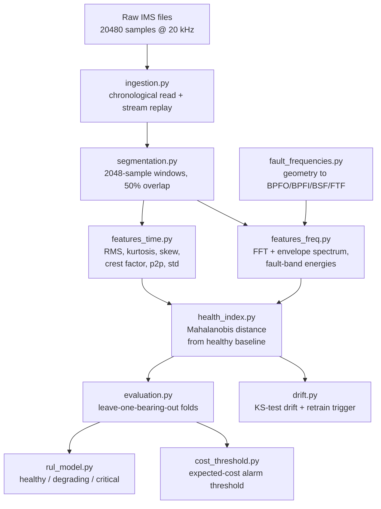

# bearing-rul-pipeline

Degradation-stage estimation for rolling-element bearings, built from **raw
20 kHz accelerometer signals** — not from a pre-featurized tabular dataset.

Ingestion → windowing → time/frequency-domain feature extraction → health
index → leak-safe evaluation → cost-sensitive alarm threshold → drift
detection. Validated end to end on the NASA IMS run-to-failure bearing
dataset.

---

## The problem

A rolling-element bearing fails at one of four places: the outer race, the
inner race, a rolling element, or the cage. A defect at any of them grows
slowly under load until the bearing seizes. An accelerometer on the housing
records this as a raw vibration waveform — 20 000 samples per second, none
of which means anything on its own.

The engineering problem is turning that stream into three answers, early
enough to act on:

1. **Is this bearing degrading?**
2. **Which part of it is degrading?**
3. **Is it close enough to failure to justify pulling the machine offline?**

This repository is about the signal processing that makes those questions
answerable, and about evaluating the answers honestly.

---

## Why this is a signal-processing project

Averaging a vibration window into a single number (RMS, peak, variance)
discards exactly the information that identifies *where* a fault is. Two
windows with identical RMS can carry completely different fault signatures.
That information survives only in the frequency domain, which is why the
core of this pipeline is spectral, not statistical.

**Characteristic fault frequencies are derived from bearing geometry, not
looked up.** Standard rolling-element kinematics turn shaft speed and
physical dimensions into the four frequencies a defect produces:

| Fault location | Frequency | At 2000 RPM (Rexnord ZA-2115) |
|---|---|---|
| Outer race | BPFO | 236.4 Hz |
| Inner race | BPFI | 296.9 Hz |
| Rolling element | BSF | 139.9 Hz |
| Cage | FTF | 14.8 Hz |

**Both a raw and an envelope spectrum are computed per window.** A bearing
impact is a short broadband knock that excites a high-frequency structural
resonance; the fault's repetition rate appears not as a clean peak in the
raw spectrum but as *amplitude modulation* riding on that resonance. The
envelope spectrum (via the Hilbert transform) demodulates the signal so the
repetition rate becomes an isolated peak — the standard technique for
detecting rolling-element faults before they are well developed.

17 features are extracted per window: 6 time-domain, 3 global spectral, and
8 fault-band energies (4 fault locations × raw and envelope spectra, each
summed over the first three harmonics).

---

## Pipeline



---

## Key technical decisions

### Window size is derived, not chosen by convention

An FFT of `N` samples at rate `fs` resolves frequency into bins of `fs/N` Hz.
At 20 kHz, a 2048-sample window gives **9.8 Hz bins** — narrow enough to
separate BPFO (236 Hz) from BPFI (297 Hz) from BSF (140 Hz), which sit
60–160 Hz apart. A 64-sample window would give 312 Hz bins and collapse all
four fault frequencies into a single bin, making the entire spectral stage
meaningless. 2048 samples is also ~102 ms, short enough that shaft speed and
load are constant across the window (the stationarity assumption the FFT
depends on) and long enough to contain ~3.4 shaft revolutions.

50% overlap doubles the number of health-state samples per snapshot. It also
means adjacent windows share half their data — which directly motivates the
evaluation strategy below.

### Health index: Mahalanobis distance from a healthy baseline

17 features per window is too many to threshold directly, and no single one
is reliable alone. Each bearing's features are scored by their Mahalanobis
distance from a healthy baseline fitted on early-life windows.

Rejected alternatives:

- **Euclidean distance** would be dominated by whichever feature has the
  largest raw scale (spectral energies are `O(10^5)`; kurtosis is `O(1)`) —
  an artifact of units, not of physics. Mahalanobis divides out each
  feature's own variance and its correlations with the others.
- **PCA / Hotelling's T²** is the right tool when the feature space is
  high-dimensional and collinear enough that estimating a full covariance
  matrix is unstable. With 17 features and hundreds of healthy windows,
  direct estimation is well-conditioned; Mahalanobis distance on the full
  covariance *is* Hotelling's T² without the dimensionality-reduction step.
- **An autoencoder** needs far more data than a few hundred early-life
  windows per bearing, and trades away interpretability for nothing here.

### Per-unit normalization, and why it is not leakage

The first end-to-end run scored **0.218** — worse than always guessing
"healthy". The cause: the healthy baseline pooled *raw* features across
several physically distinct bearings. Nominally identical bearings differ in
noise floor, mounting stiffness, and sensor gain, so a baseline pooled from
three of them represents none of them, and every window of a fourth looked
anomalous for reasons unrelated to wear.

The fix is to z-score each bearing's features against **its own** early-life
window before pooling. This is legitimate per-asset calibration, not
leakage: every bearing in this dataset begins healthy by construction, a new
bearing in production gets the same short break-in calibration, and the
normalization never touches information about *when or whether* the bearing
failed. Accuracy went from 0.218 to **0.544**.

### Stage classification, not RUL regression

Only **4 bearings in the entire dataset run to failure**. A regressor
learning "trajectory shape → time-to-failure" is fitting 4 independent
examples of what failure looks like; leave-one-bearing-out cross-validation
can measure that honestly but cannot manufacture more trajectories.

Stage classification (healthy → degrading → critical) only has to learn
thresholds on the health index, and each bearing still contributes thousands
of windows self-labeled by their position in that bearing's life. It is also
closer to what a maintenance planner acts on. RUL regression remains a
documented option, deliberately not built.

Stage boundaries are set at 30% and 10% of life remaining. These are stated
defaults, not tuned values.

### Evaluation splits by bearing — never randomly

Random splitting would be catastrophic here, in two compounding ways. With
50% overlap, adjacent windows share half their samples, so a "test" window
can be a near-copy of a training window. Even without overlap, windows from
the same bearing share that bearing's noise floor and resonances — a model
can score well by recognizing the *bearing*, not by detecting degradation.

With only 4 run-to-failure units, a single 80/20 split would evaluate on one
bearing. **Leave-one-bearing-out** cross-validation is used instead: each
bearing is held out exactly once, trained on the other three. A test asserts
no unit appears on both sides of any fold.

The guarantee is enforced rather than documented. `assert_no_unit_overlap`
raises an explicit `AssertionError` instead of using a bare `assert`
statement, because Python strips asserts under `-O` — a leakage guard that
disappears in optimized execution is a comment, not a control. A regression
test constructs the exact mistake a naive positional split would make
(`rows[:80]` / `rows[80:]`, which cuts through the middle of a bearing) and
asserts the guard catches it.

Splitting is available at two levels. `leave_one_unit_out` partitions a list
of unit IDs; `split_by_unit` partitions a flat, row-aligned array of unit
labels and returns boolean row masks directly. The second exists because the
caller's own indexing step — turning "hold out bearing 3" into actual rows —
is where leakage is reintroduced in practice, and returning masks removes
that step entirely.

### Alarm threshold from a cost model, not from accuracy

A missed failure and a false alarm are not equally expensive. Accuracy — and
any threshold chosen to maximize it — implicitly assumes they are. The
threshold here is swept to minimize expected cost under an explicit ratio
(a missed failure assumed 10× a wasted inspection; illustrative, and a
parameter rather than a finding). Raising that ratio to 100× lowers the
threshold and trades false alarms for missed failures, as it should.

Critically, the threshold is fitted on **training bearings only** and then
applied unchanged to the held-out bearing. An earlier version swept it
against the held-out bearing's own labels — the same leakage this project
exists to avoid, one module later. Fixing it made the reported numbers
substantially worse and substantially more honest (see below).

### Drift detection guards the baseline

Every fitted component — baseline, stage thresholds, alarm threshold —
assumes incoming data resembles what it was fitted on. Sensor recalibration
or a changed operating regime breaks that silently. Per-feature two-sample
Kolmogorov–Smirnov tests compare a current batch against the reference;
KS is nonparametric, which matters because several of these features are
strongly non-Gaussian. An alarm requires a substantial *fraction* of
features to shift together, since testing 17 features guarantees some will
cross any single p-value threshold by chance.

The retrain trigger fires only after three consecutive drift-positive
batches, and deliberately does not retrain automatically: retraining
redefines "healthy", and doing that unattended risks a degrading bearing
poisoning the new baseline.

---

## Results

Leave-one-bearing-out across the 4 bearings that run to failure. The alarm
threshold is fitted on training bearings only.

| Held-out bearing | Stage accuracy | Alarm threshold | False-alarm rate | Missed-failure rate |
|---|---:|---:|---:|---:|
| `1st_test_b3` | 0.536 | 126.72 | 0.004 | 0.796 |
| `1st_test_b4` | 0.380 | 150.12 | 0.070 | 0.771 |
| `2nd_test_b1` | 0.533 | 124.30 | 0.171 | 0.021 |
| `3rd_test_b3` | 0.726 | 94.61 | 0.000 | 0.747 |
| **Mean** | **0.544** | — | — | — |

**Read these numbers carefully — they are reported as measured, not as
advertised.** Mean stage accuracy of 0.544 beats random guessing across
three classes (0.33) but does **not** beat the majority-class baseline of
~0.70 obtained by always predicting "healthy". The alarm threshold learned
from training bearings misses 75–80% of critical windows on three of the
four held-out bearings.

The most likely cause is that per-unit normalization aligns each bearing's
*healthy* regime to a common scale but does not guarantee that a *critical*
excursion scales the same way across bearings — different failure modes
(inner race vs. outer race vs. roller) produce different magnitude jumps in
the health index. Addressing this properly needs either per-failure-mode
thresholds or a health index normalized by degradation magnitude rather than
by healthy-period spread.

This limitation is only visible *because* the evaluation leak was fixed. The
leaked version reported missed-failure rates of 0.287, 0.005, and 0.000 on
the folds now showing 0.796, 0.771, and 0.021.

---

## Limitations

- **n = 4.** Only four bearings in the dataset run to failure. Leave-one-
  bearing-out is the correct response to that, but four folds is a small,
  high-variance sample and the fold spread (0.380–0.726) reflects it.
- **The alarm threshold does not transfer well across bearings** (above).
- **Cost ratio is illustrative.** The 10:1 missed-failure-to-false-alarm
  ratio is a parameter, not a figure sourced from a real maintenance budget.
- **Stage boundaries are stated defaults** (30% / 10% of life remaining),
  not optimized.
- **One channel per bearing.** Test set 1 provides two accelerometers per
  bearing; only the first is used.
- **`SNAPSHOT_STRIDE = 10`** by default — every 10th snapshot is processed,
  covering each bearing's full life at reduced temporal density. Set to 1
  for a full-fidelity run.

---

## Quick start

```bash
pip install -r requirements-dev.txt
pip install -e .
```

Download the NASA IMS bearing dataset (~1 GB compressed, ~3 GB extracted):

```bash
curl -o ims_bearings.zip "https://phm-datasets.s3.amazonaws.com/NASA/4.+Bearings.zip"
```

Extract it into `data/raw/` — the archive nests a `.7z` containing three
`.rar` files, one per test set. The expected final layout is:

```
data/raw/4. Bearings/1st_test/1st_test/        2156 files, 8 channels
data/raw/4. Bearings/2nd_test/2nd_test/         984 files, 4 channels
data/raw/4. Bearings/3rd_test/4th_test/txt/    6324 files, 4 channels
```

(The third test set is labeled `4th_test` inside NASA's own archive. This is
a quirk of the original release, not a mistake.)

Run the pipeline:

```bash
python scripts/run_pipeline.py
```

Run the test suite and linter:

```bash
pytest
ruff check .
```

---

## Repository layout

```
bearing_pdm/
  ingestion.py           read snapshots chronologically; replay as a live stream
  segmentation.py        overlapping fixed-length windows
  fault_frequencies.py   bearing geometry to BPFO/BPFI/BSF/FTF
  features_time.py       RMS, kurtosis, skewness, crest factor, p2p, std
  features_freq.py       FFT + envelope spectrum, fault-band energies
  health_index.py        Mahalanobis distance from a healthy baseline
  evaluation.py          leave-one-bearing-out splits
  rul_model.py           healthy / degrading / critical staging
  cost_threshold.py      expected-cost alarm threshold sweep
  drift.py               KS-test drift detection + retrain trigger
scripts/
  run_pipeline.py        end-to-end run with leave-one-bearing-out evaluation
tests/                   17 tests, including a leakage guard on the splitter
docs/CONTEXT.md          architecture reference and design-decision record
```

CI runs `ruff` and the full test suite on Python 3.11 and 3.12.

---

## Dataset

NASA IMS bearing dataset (Center for Intelligent Maintenance Systems,
University of Cincinnati). Three run-to-failure tests, four bearings each on
a shaft held at 2000 RPM under constant radial load, recorded until failure.
Each snapshot is 20 480 samples at 20 kHz (~1 second), captured roughly every
10 minutes across each bearing's life.

Four bearings across the three tests reach failure within their recording:
test 1 bearings 3 and 4, test 2 bearing 1, test 3 bearing 3. These are the
four units used for evaluation.

---

## References

- Qiu, Lee, Lin & Yu (2006). *Wavelet filter-based weak signature detection
  method and its application on rolling element bearing prognostics.*
  Journal of Sound and Vibration — source of the IMS dataset and bearing
  geometry.
- Randall & Antoni (2011). *Rolling element bearing diagnostics — a
  tutorial.* Mechanical Systems and Signal Processing — envelope analysis.
- Harris (2001). *Rolling Bearing Analysis*, 5th ed., ch. 20 — fault
  frequency kinematics.
- Dyer & Stewart (1978). *Detection of rolling element bearing damage by
  statistical vibration analysis.* — kurtosis as an early indicator.
- ISO 13373-1 — condition monitoring and diagnostics of machines.

---

## Author

**Hibat Allah Chmicha** — Data Science & Data Engineering, INSEA Rabat
